# ShopSphere — End-to-End MERN E-Commerce Platform

**Full Stack Development V8 · Module 5 module-end assignment — "End-to-End MERN Stack E-Commerce Platform –
Frontend + Backend Integration"** · by **Fathima K H** ([github.com/fathimakh](https://github.com/fathimakh))

ShopSphere is a complete online store: a **React (Vite) + Redux Toolkit + Tailwind** frontend talking to a
**Node.js + Express + MongoDB** REST API with **JWT + bcryptjs** authentication, **role-based access control**,
product **filtering / sorting / search**, orders with real stock management, a validated **contact form**, and
**RapidMiner-powered product recommendations**.

| | |
|---|---|
| 🌐 **Live website** | _added after deployment_ — planned: `https://shopsphere-web.onrender.com` (or Netlify / Vercel) |
| 🔌 **Live API** | _added after deployment_ — planned: `https://shopsphere-api.onrender.com/api/health` |
| 📦 **Repository** | `https://github.com/fathimakh/<repository-name>` |
| 👤 **Demo shopper** | `demo@shopsphere.dev` / `Demo@1234` |
| 🛡️ **Demo admin** | `admin@shopsphere.dev` / `Admin@123` |

The login page has **"Use demo shopper" / "Use admin demo"** buttons that fill these in.

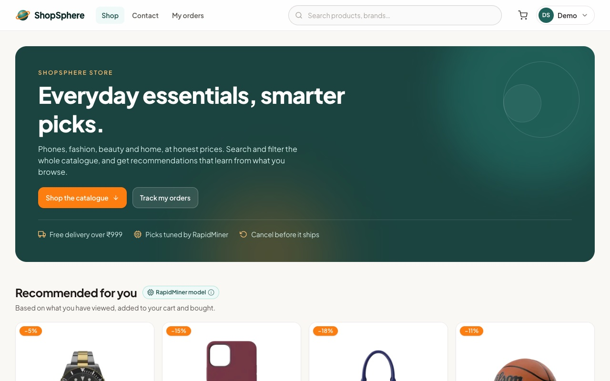

## What it does

**Shoppers** browse a 60-product catalogue (search, category, price range, rating and stock filters, six sort
orders, pagination — all kept in the URL), open product pages with reviews and **"You may also like"**, get
**"Recommended for you"** picks based on what they viewed, added and bought, manage a **Redux cart** that
survives reloads and follows them across devices, check out with cash on delivery or a simulated card
payment, track and cancel orders, write reviews, edit their profile and send messages through the contact form.

**Admins** (role-based, enforced by the API and the UI) see a dashboard, create / edit / delete products,
move orders through pending → processing → shipped → delivered (or cancel, which restocks), manage user roles,
read contact messages, and run the **RapidMiner loop**: export the training data, import the model RapidMiner
produced, preview recommendations.

## Architecture

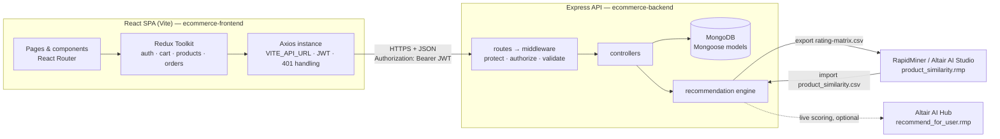

## Repository structure

One Git repository with both projects (the assignment's two folders, each with its own `package.json`,
`.env.example` and README), so the history shows the full-stack integration in one place.

```
Module-5/
├── ecommerce-backend/        # Node.js + Express + MongoDB API — see ecommerce-backend/README.md
│   ├── index.js, config/, models/, controllers/, routes/, middleware/   (assignment structure)
│   ├── services/, validators/, utils/, scripts/ (seed), tests/, postman/
│   └── rapidminer/           # RapidMiner processes, training data, RapidMiner output, runner, guide
├── ecommerce-frontend/       # React + Vite + Redux Toolkit + Tailwind — see ecommerce-frontend/README.md
│   └── src/ assets/ components/ redux/{store,slices,thunks}/ api/ pages/ App.jsx main.jsx index.css
├── e2e/                      # Playwright browser smoke test of the running stack
├── docs/
│   ├── API_CONTRACT.md       # endpoints, payloads, error codes, CSV formats shared by both apps
│   └── screenshots/          # every page on desktop, tablet and phone
└── render.yaml               # Render blueprint: API web service + static site
```

## Run it locally

Requirements: **Node.js 20+** (22 recommended) and **MongoDB** (local, Docker or Atlas).

```bash
# 1. MongoDB (skip if you already have one; adjust MONGO_URI otherwise)
docker run -d --name m5-mongo -p 27035:27017 mongo:7

# 2. API → http://localhost:5050
cd ecommerce-backend
npm install
cp .env.example .env            # set JWT_SECRET to a long random string
npm run seed                    # demo catalogue, users, orders, behaviour data
npm run dev

# 3. Web app → http://localhost:5175   (second terminal)
cd ecommerce-frontend
npm install
cp .env.example .env            # VITE_API_URL=http://localhost:5050/api
npm run dev
```

Environment variables are documented in both READMEs and `.env.example` files; real `.env` files are
git-ignored. The API reads `MONGO_URI`, `JWT_SECRET`, `CLIENT_URL` (CORS allow-list) and the optional
`RAPIDMINER_*` settings; the frontend reads only `VITE_API_URL`.

## Testing and verification

| Check | Command | Result |
|---|---|---|
| API unit + integration tests (`node:test` + supertest) | `cd ecommerce-backend && npm test` | **130 / 130 passing** |
| Postman collection (newman) | `npm run test:api` | **77 requests, 145 / 145 assertions** ([summary](ecommerce-backend/postman/results/newman-summary.txt)) |
| Browser smoke test (Playwright, real API + MongoDB) | `cd e2e && npm test` | **43 / 43 checks** on desktop, tablet and phone |
| Frontend lint | `cd ecommerce-frontend && npm run lint` | 0 errors, 0 warnings |
| Frontend production build | `npm run build` | ✓ |
| RapidMiner process validation (against the RapidMiner Studio 9.7 source) | `python3 -I ecommerce-backend/rapidminer/tools/validate_processes.py` | OK |
| RapidMiner run (RapidMiner Studio Core 9.7.0) | `ecommerce-backend/rapidminer/tools/core-runner/run.sh …` ([log](ecommerce-backend/rapidminer/output/run-log.txt)) | 849 similarity pairs, identical to the Python reference; imported 849 / skipped 0 |

## Recommendation system (RapidMiner)

1. Every view, cart add, review and purchase is stored with a weight (1 / 3 / 4 / 5).
2. Admins export the **product × user rating matrix** (`Admin → RapidMiner`, or `GET /api/analytics/export/rating-matrix.csv`).
3. **`rapidminer/processes/product_similarity.rmp`** computes cosine item-to-item similarities with
   *Cross Distances* and writes `product_similarity.csv`. It was run with RapidMiner Studio Core 9.7.0
   (`rapidminer/tools/core-runner`); the result is committed in
   [`rapidminer/output/`](ecommerce-backend/rapidminer/output) and opens in Altair AI Studio too.
4. The file is imported back (`Admin → RapidMiner → Import`, or `POST /api/analytics/import`); the API now
   serves **"Recommended for you"** (Σ weight × similarity over the shopper's history) and **"You may also
   like"** from the RapidMiner model, with a reason per product.
5. Optional live mode: `recommend_for_user.rmp` deployed on **Altair AI Hub** and `RAPIDMINER_SCORING_URL` set.

If no RapidMiner model is available, the API computes the same cosine model itself, then falls back to
popularity — recommendations are never empty, and the UI badge always says which source was used. Full guide,
data, reference values and verification status: [`ecommerce-backend/rapidminer/README.md`](ecommerce-backend/rapidminer/README.md).

## Deployment

Prepared for **Render** (API + static site via [`render.yaml`](render.yaml)) with **MongoDB Atlas**; the
frontend also deploys to **Netlify** ([`netlify.toml`](ecommerce-frontend/netlify.toml)) or **Vercel**
([`vercel.json`](ecommerce-frontend/vercel.json)), all with SPA rewrites.

1. MongoDB Atlas: free cluster, database user, network access `0.0.0.0/0`, copy the `mongodb+srv://…/shopsphere` URI.
2. Render → *New → Blueprint* → this repository. Set `MONGO_URI`, `CLIENT_URL` (the site URL) for
   `shopsphere-api` and `VITE_API_URL` (`https://<api>.onrender.com/api`) for `shopsphere-web`.
3. Seed Atlas once: `cd ecommerce-backend && MONGO_URI="<atlas uri>" npm run seed`.
4. Open the site, log in with the demo accounts, and put both live URLs at the top of this README.

## Assignment requirements → where they are met

| Requirement (PDF) | Implementation |
|---|---|
| JWT authentication + bcryptjs password encryption | `models/user.js` (pre-save hash), `controllers/authentication.js`, `utils/generateToken.js`, `middleware/authMiddleware.js` |
| CRUD APIs for products, orders, user profiles | `controllers/productController.js`, `orderController.js`, `userProfile.js` + routes |
| Product filtering, sorting, searching via API | `GET /api/products?search=&category=&minPrice=&maxPrice=&minRating=&inStock=&sort=&page=` |
| RapidMiner-based recommendation system | `rapidminer/` processes + export/import endpoints + `services/recommendationEngine.js` + UI rails |
| RBAC (admin / user) via middleware | `authorize('admin')` on admin routes; `ProtectedRoute requiredRole="admin"` in the UI |
| Scalable folder architecture, clean routing, modular controllers | assignment structure + `services/`, `validators/`, `utils/` |
| Listing, detail view, filtering and search with React Router + Axios | `pages/Home.jsx`, `pages/ProductDetail.jsx`, `hooks/useProductQuery.js`, `api/axiosInstance.js` |
| Redux for cart and login | `redux/slices/cartSlice.js`, `authSlice.js` + thunks, persistence, server cart sync |
| Responsive UI with Tailwind | Tailwind v4; checked at 375 / 768 / 1280 px ([screenshots](docs/screenshots)) |
| Contact form with validation | `pages/Contact.jsx` + `utils/validators.js`; server validation in `validators/contactValidators.js` |
| Login / logout synchronised with backend auth | login/register/me/logout thunks, token validation on start, revocation, expiry redirect |
| Frontend consumes auth, products **and orders** endpoints | checkout → `POST /api/orders`, My orders, cancel, admin order management |
| Environment variables (Vite + Node) | `VITE_API_URL`; `MONGO_URI`, `JWT_SECRET`, `CLIENT_URL`, `RAPIDMINER_*` (`.env.example` in both apps) |
| Errors, loading states, token validation handled gracefully | skeletons, error panels with retry, field errors, 401 interceptor → `/login?expired=1`, slow-server banner |
| Deployed on Netlify / Vercel / Render with GitHub | configs ready; live URLs above once deployed |

## Screenshots

| | | |
|---|---|---|
| 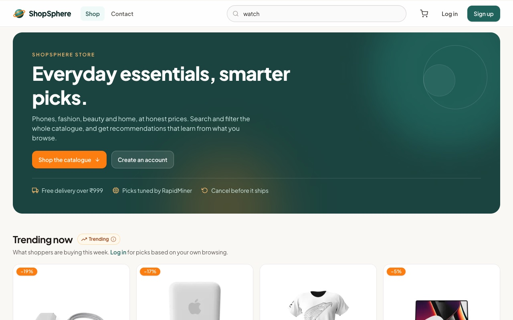 Search | 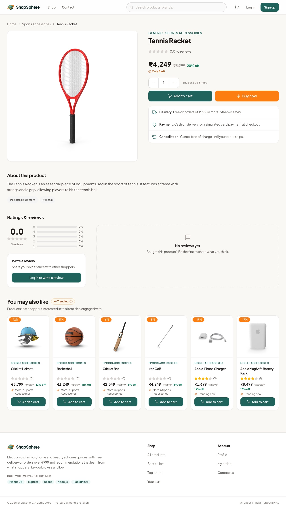 Product + "You may also like" | 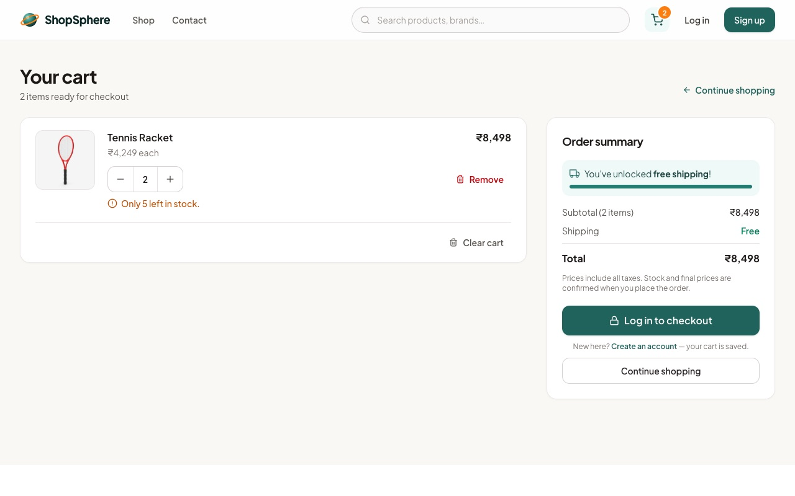 Redux cart |
| 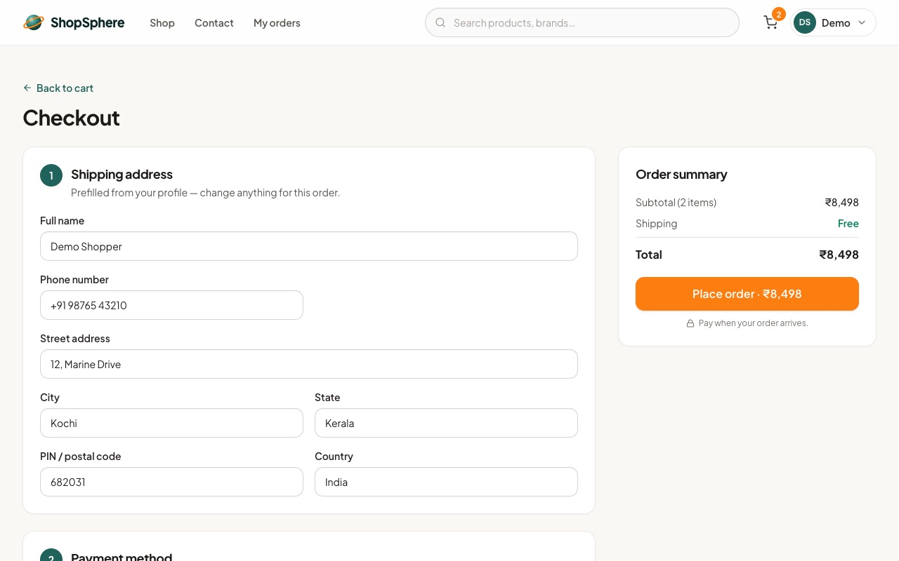 Checkout | 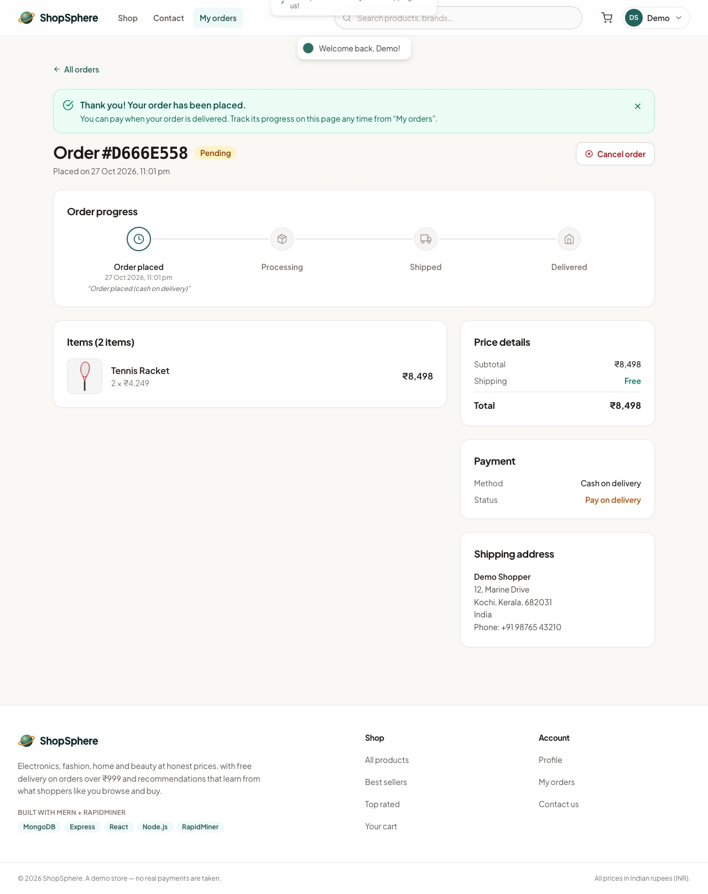 Order placed | 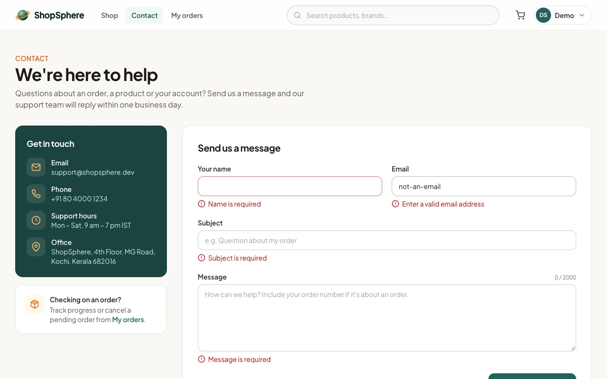 Contact validation |
| 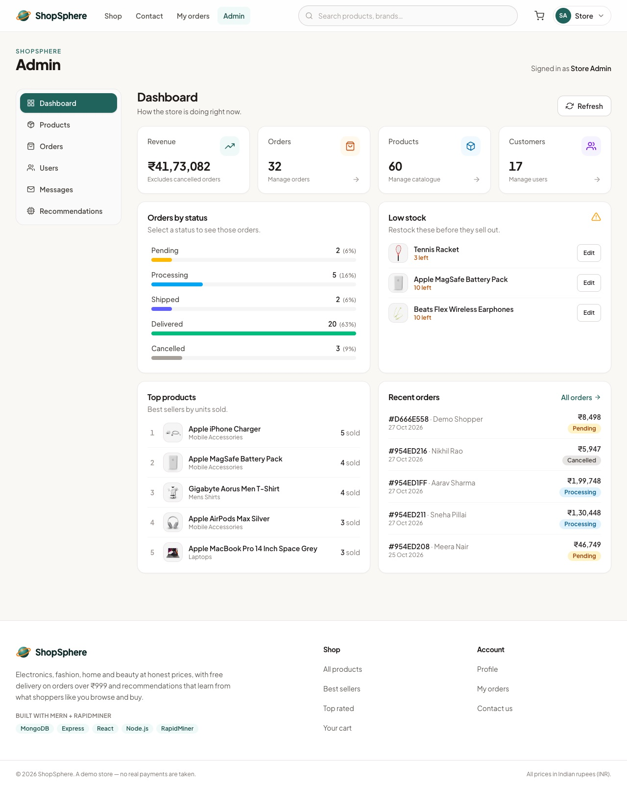 Admin dashboard | 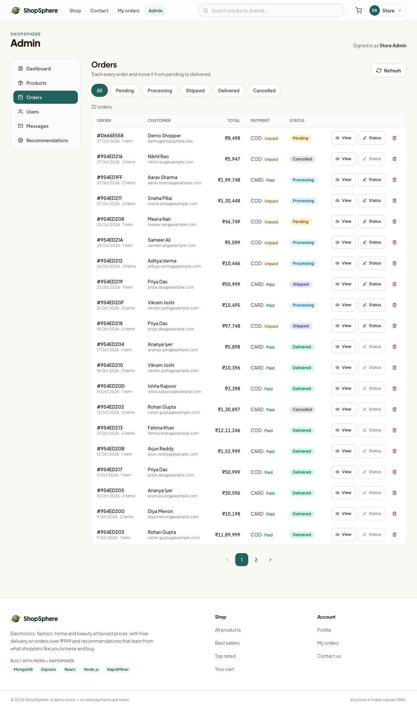 Order management | 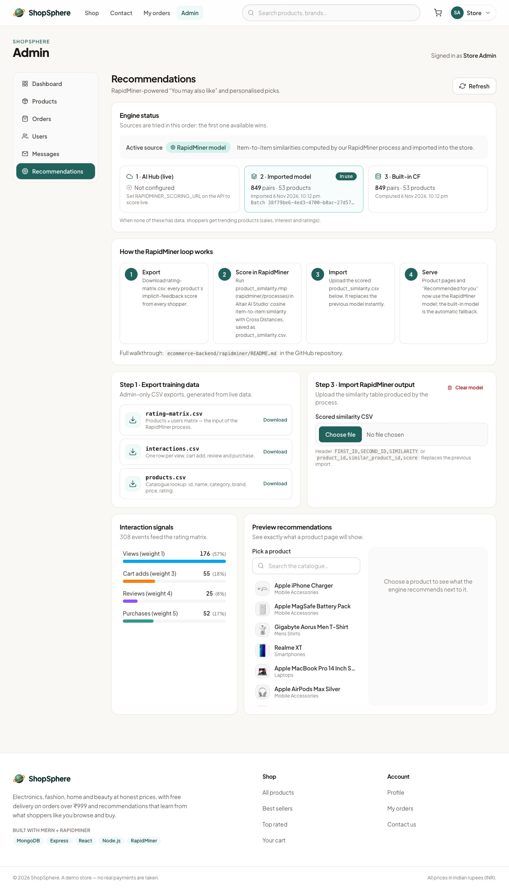 RapidMiner panel |
| 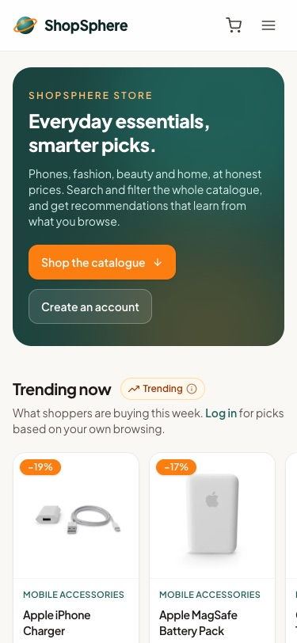 Phone | 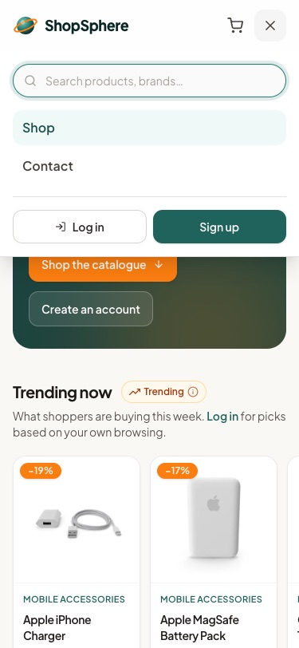 Phone menu | 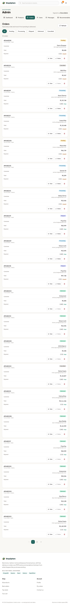 Tablet |

All 29 screenshots: [`docs/screenshots/`](docs/screenshots).

---

Author: **Fathima K H** · Entri Full Stack Development V8 · Module 5
